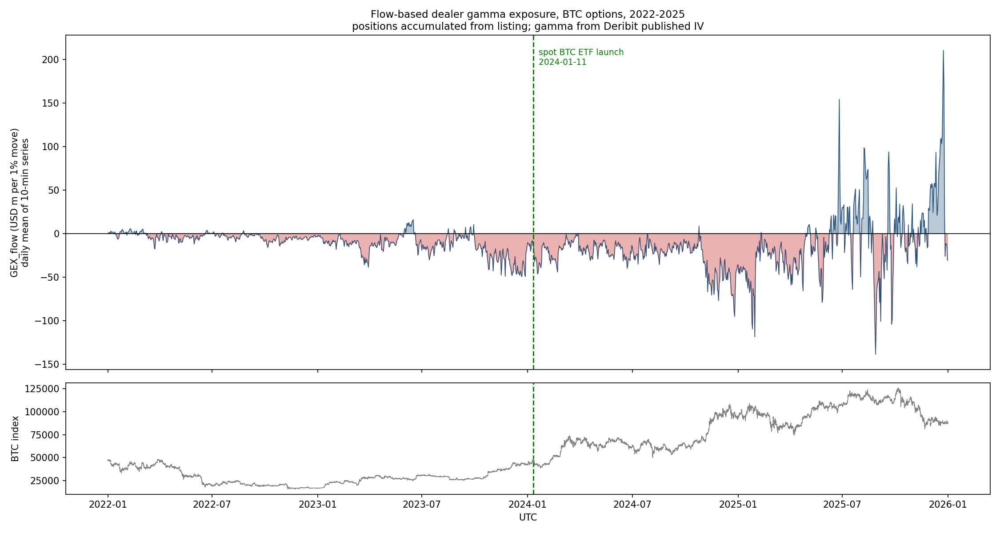
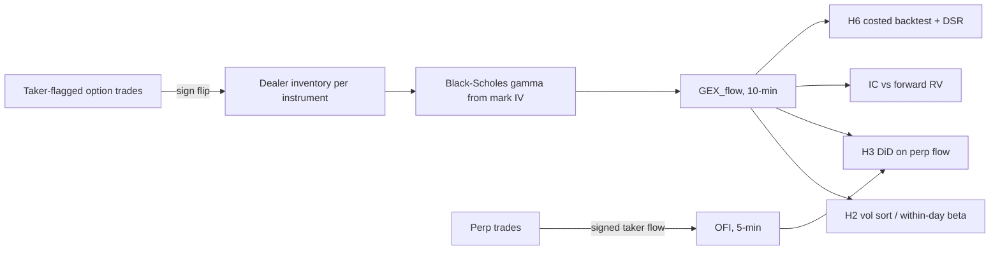
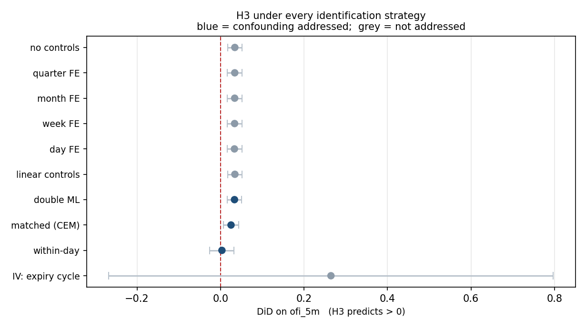
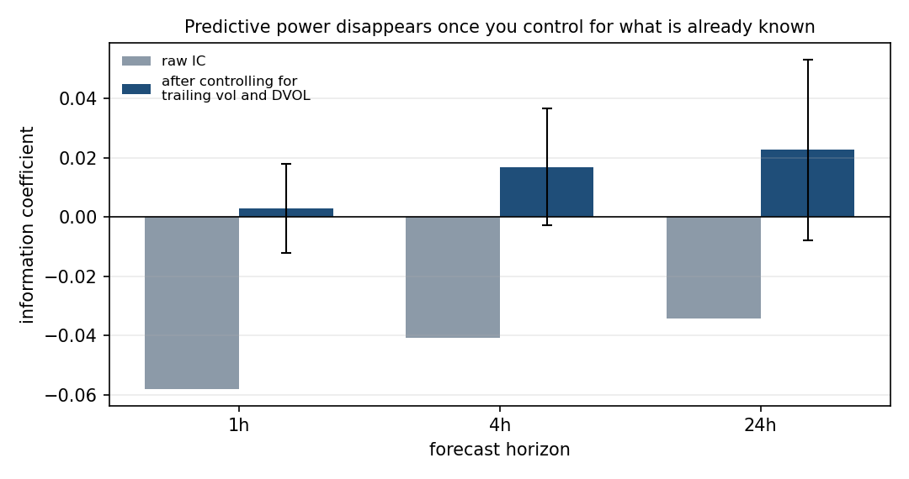
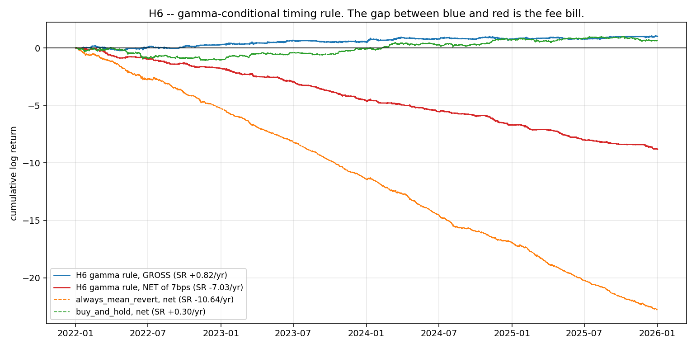

# Flow-Based Dealer Gamma in Bitcoin Options

**Reconstructing dealer gamma exposure from the aggressor flag on 16.9M Deribit option trades, then testing whether the delta hedge it implies is visible in 139M perpetual-futures trades.**

The standard GEX indicator assumes customers buy calls and sell puts and signs open interest accordingly. Deribit flags the taker on every trade, so dealer inventory can be counted instead of assumed: a taker buy is a dealer sell. This repository builds that signed inventory for 57,470 option instruments over 2022–2025, prices it with Black–Scholes gamma from the exchange's own mark IV, aggregates it to a 10‑minute GEX series, and tests the hedging channel directly — dealers who are short gamma must chase a move in the perpetual, dealers who are long gamma must lean against it.

Headline, net of every correction: the hedge **is** observable in perpetual order flow (DiD on 5‑min order-flow imbalance +0.034, t = 3.8, robust to fixed effects, double machine learning, matching and IV), it **does not** identify on within-day variation, it carries **zero** incremental forecasting content over trailing realised volatility and DVOL, and a gamma-conditioned reversal rule breaks even at **0.72 bps** per unit of turnover against a 7 bps taker cost. The gross edge that rule shows is bid–ask bounce (ρ₁ = −0.021, ρ₂…ρ₁₂ ≈ 0). *Mechanism real, alpha absent.* Data cost: €0; no credentials required.



## Run it

Python ≥ 3.11. Every endpoint used is public; `.env` is optional and buys only rate-limit headroom.

```bash
git clone https://github.com/YV0007/crypto-gamma.git && cd crypto-gamma
python3 -m venv .venv && source .venv/bin/activate
pip install -e '.[dev]'

python3 -m src.fetch.instruments      # 121,554 instruments, history host
./scripts/run_backfill.sh             # options -> perp -> OHLCV/DVOL/funding; resumable, ~3.4 GB
python3 scripts/to_parquet.py         # JSONL -> partitioned parquet, deduped on (instrument, trade_seq)
./scripts/reproduce_all.sh            # inventory -> gamma -> GEX -> panel -> H2/H3/H4/H6/IC -> outputs/, ~40 min
python3 -m pytest tests/ -q           # 172 tests
```

Every parameter lives in [`config.yaml`](config.yaml); nothing is hard-coded. Each stage is also a module (`python3 -m src.build.pipeline`, `src.analysis.h3_perpflow`, …).

## How it works



**1. Sign.** `direction` describes the taker; the dealer is the passive counterparty.

```
taker buy   ->  dealer_flow = -amount / contract_size
taker sell  ->  dealer_flow = +amount / contract_size
position[i, t] = position[i, t-1] + dealer_flow[i, t]
```

Position starts at 0 on `creation_timestamp`, is forward-filled between trades, and is forced to 0 at `expiration_timestamp`. `contract_size` is joined per instrument (options 1.0, `BTC-PERPETUAL` 10.0), never a global constant. Block trades are **included**: they are 1.6% of trades but 38% of volume and 97% of net dealer flow; excluding them halves measured GEX and flips the sign of 15% of intervals.

**2. Gamma.** Deribit stores no historical greeks (`ticker` and `book_summary` are live-only on both hosts), but every historical trade carries the exchange mark `iv`. Gamma is recomputed in closed form, $\Gamma = \phi(d_1)/(S\,\sigma\sqrt{T})$, with $r = 0$, IV clipped to [1%, 500%], and $T$ floored at 6 minutes. Calibrated against Deribit's published gamma on 161 live instruments: correlation 0.9976, median ratio 1.014, no dependence on spot, moneyness or maturity — so Deribit publishes the standard USD convention despite inverse settlement. Aggregate check on 1,008 live instruments: signed GEX ratio 0.992, gross 0.996 ([table](outputs/tables/gamma_aggregate_validation.json)).

**3. Exposure.** Per 1% spot move, USD:

$$\mathrm{GEX}_t=\sum_i \mathrm{position}_{i,t}\;\Gamma_{i,t}\;S_t^2\times0.01\times\mathrm{contract\_size}_i$$

Positive: dealers long gamma, hedge against the move. Negative: short gamma, hedge with it. Grid is 1.70×10⁸ (instrument × interval) cells, 1.48×10⁸ live, 7.76×10⁷ priced (81% of position weight; unpriced cells are excluded and reported, never zero-filled).

**4. Alignment.** Every column at $t$ uses data at or before $t$: greeks via backward `merge_asof` bounded by 24h staleness, spot as nearest-prior index price, trailing realised vol, last-published DVOL and funding. `tests/test_panel.py::TestNoLookahead` rebuilds the panel on data truncated at $T$ and asserts bit-identity for all $t \le T$.

**5. Perp side.** Signed taker flow on `BTC-PERPETUAL`, sign *not* inverted: a hedging dealer crosses the spread. 139M trades stream from raw gzip through a process pool into 5‑minute `net_usd`, `volume_usd`, OFI buckets without a 20 GB intermediate.

## Identification

Events are 5‑min returns with $|r_t| > 1\sigma$, $\sigma$ from a trailing 30‑day window ending at $t-1$ (76,812 events). The outcome is forward signed perp flow over $t{+}1 \ldots t{+}k$, $k \in \{5, 15, 30\}$ min. The statistic flips with the move, so a constant flow bias cannot produce it:

$$\mathrm{DiD}=\big[\bar F_{\gamma<0}-\bar F_{\gamma>0}\big]_{\text{rally}}-\big[\bar F_{\gamma<0}-\bar F_{\gamma>0}\big]_{\text{selloff}}$$

Gamma sign flips on only 18.7% of days, so the pooled estimate compares different days. The same coefficient is therefore estimated under a ladder of strategies, all with day-clustered SEs ([`h3_identification.py`](src/analysis/h3_identification.py), [results](outputs/tables/h3_identification.csv)):

| strategy | assumption | DiD (OFI, 5m) | t |
|---|---|---:|---:|
| pooled | none | +0.0343 | 3.83 |
| quarter / month / week / day FE | time-varying confounders are slow | +0.0341 … +0.0334 | 3.7–3.8 |
| linear controls | vol, volume, funding, move size, spot, hour, expiry cycle | +0.0345 | 3.85 |
| double ML | same controls, `HistGradientBoosting`, cross-fit by `GroupKFold(day)` | +0.0335 | 3.91 |
| coarsened exact matching | bins on vol × volume × quarter, 87% retained | +0.0252 | 2.77 |
| IV on expiry cycle | 2SLS; exclusion restriction weak, exploratory | +0.265 | 0.97 |
| **within-day, mixed-sign days** | cleanest; 272 days, median \|GEX\| 2.8× smaller | **+0.0035** | **0.23** |

Dose-response by |GEX| quintile: t = −3.3, 0.0, 3.9, 5.2, 3.4. Pre-event window and scrambled-direction placebos are null. Post-ETF (2024‑01‑11) the effect is flat across distance-to-expiry (t 2.6–5.3 beyond 1 day); 2022, where the book is 8× smaller, reverses sign. Whether the within-day null is confounding or attenuation (weak treatment + noisy label on days gamma passes through zero) is argued in [`STATUS.md` §6b](STATUS.md) and left open; the pooled H3 numbers are excluded from the multiple-testing family on that ground.



## Results you can regenerate

Seven pre-declared primary tests, Benjamini–Hochberg at 5% FDR ([table](outputs/tables/multiple_testing.csv)). HAC = Newey–West with lag $\lfloor 4(T/100)^{2/9}\rfloor$; CIs are moving-block bootstraps over whole UTC days.

| hypothesis | statistic | estimate | p | q | survives |
|---|---|---:|---:|---:|:-:|
| H2 | within-day β of RV on GEX, excl. final expiry day | −2.2e‑4 | 0.0015 | 0.010 | yes |
| H2 | within-day β, baseline | −1.2e‑4 | 0.0052 | 0.018 | yes |
| H2 | Q5 − Q1 realised vol, rolling-60d z | −3.2e‑4 | 0.035 | 0.081 | no |
| H4 | H2 β pre vs post ETF (Chow) | +3.1e‑5 | 0.45 | 0.78 | no |
| H3 | DiD OFI 5 / 15 / 30 m, within-day | ≈0 | 0.82–0.91 | 0.91 | no |

**Forecasting content.** Spearman IC of GEX against forward RV at 1h / 4h / 24h is −0.058 / −0.041 / −0.034 raw and **+0.003 / +0.017 / +0.023 after residualising both sides on trailing RV and DVOL**, every interval covering zero ([table](outputs/tables/signal_ic.csv)). Directional IC on forward returns: −0.004 to −0.018, null. Inference: block bootstrap over days plus a daily-IC information ratio.



**H2 detail.** Sorting on the raw GEX level sorts calendar time (50% of GEX variance is between-month; `corr(GEX, year) = −0.36`) and manufactures a wrong-signed result from two trends. Sorting on a trailing 60‑day z-score — the only strictly backward-looking detrend — gives the predicted sign. The within-day regression is the stronger form: −1.2e‑4 (t = −2.8), −2.2e‑4 (t = −3.2) once the final day before expiry is dropped, where the 6‑minute $T$ floor makes gamma explode.

## Execution, costs and the bounce

Rule declared before the first run: mean-revert the last 10‑min return when rolling-60d $z(\mathrm{GEX}) \ge 1$, follow it when $z \le -1$, flat otherwise, 1h hold. Execution is **taker** — the signal fires on a return that has already printed, so it lifts the offer — costed at 5 bps fee + 2 bps slippage on $|\Delta\text{position}|$, charged from the first run. Regime threshold is fixed in z units; a sample quantile of $z$ would be lookahead.

| | gross SR | net SR | turnover / yr | breakeven cost |
|---|---:|---:|---:|---:|
| gamma rule | +0.82 | −7.03 | 3,509 | 0.72 bps |
| always mean-revert | +0.87 | −10.64 | 8,782 | 0.52 bps |
| always momentum | −0.87 | −12.33 | 8,782 | — |
| buy and hold | +0.30 | +0.30 | 0 | — |

Ten-minute returns have $\rho_1 = -0.0213$ and $\rho_k \approx 0$ for $k > 1$: a price zig-zagging inside a spread that did not move. The gross Sharpe *is* that spread, and a taker pays it rather than earns it. Gamma conditioning does not improve the prediction (gross 0.82 < 0.87 unconditional); it cuts turnover 60% and lifts the breakeven cost 38%. All 50 specifications of the sweep (threshold × lookback × hold) are in the [specification log](outputs/tables/specification_log.csv), losers included, and the Deflated Sharpe bar is computed from that count; the DSR variance term is flagged as unreliable here because Sharpe dispersion across holding periods is deterministic cost, not estimation noise.



## Data pipeline

| | rows | notes |
|---|---:|---|
| BTC option trades | 16,888,077 | 1,461 days, no gaps; `iv`, `index_price`, `block_trade_id` on every row |
| BTC-PERPETUAL trades | 139.3M | streamed, never materialised |
| 1‑min OHLCV | 2.1M | |
| DVOL, funding | 35,065 / 35,064 | DVOL resolution pinned to 3600 — `1` and `60` return empty without error |
| instruments | 121,554 | from `history.deribit.com`; `www` returns 56 |
| historical open interest / greeks | none | not published; forward `launchd` collector in `deploy/` |

* **Client.** `httpx` async, shared token bucket at 15 req/s, 8 day-workers, exponential backoff with jitter, retry on JSON‑RPC 10028 / 10006 / 13009, page size shrinks on repeated disconnects.
* **Resumability.** One UTC day is atomic: fetch → temp file → `fsync` → rename → SQLite checkpoint. `SIGINT`/`SIGTERM` drain in-flight days, so files and checkpoints never disagree.
* **Endpoint deviation, proven.** Currency-level time-window paging (~5k requests) replaces per-instrument `trade_seq` paging (~120k). `scripts/validate_endpoint_equivalence.py` pages 12 instruments (2–5,615 trades) both ways and requires an exact `trade_id` set match. Page-boundary duplicates (49 in 555,365 rows) are dropped on `(instrument_name, trade_seq)`.
* **Specification log.** Every analysis appends `(spec_id = hash(hypothesis, params), config_sha, sharpe)`; trials are counted by distinct `spec_id` so re-runs do not inflate the deflation.

## What is included

```
src/fetch/      async client, day-partitioned runner, SQLite checkpoints, instruments, option/perp trades, OHLCV/DVOL/funding, OI snapshot collector
src/build/      inventory (sign, blocks, lifecycle), black_scholes, greeks alignment, gex, perp_flow, panel, chunked pipeline
src/analysis/   h2_volatility, h3_perpflow, h3_identification, h4_structural, h6_strategy, signal_ic
src/utils/      stats (HAC OLS, Newey-West, block bootstrap, PSR/DSR, MinTRL, Benjamini-Hochberg), speclog
tests/          172 tests: sign invariants, GEX arithmetic, lifecycle, no-lookahead rebuild, cost accounting, HAC/bootstrap/DSR
scripts/        backfill, parquet export, endpoint validation, API recon, reports, reproduce_all.sh
outputs/        tables (machine-readable results), working paper, WUTIS deck
```

[`CONTEXT.md`](CONTEXT.md) — hypotheses, prior work, statistical standards declared before results. [`STATUS.md`](STATUS.md) — full record including the two construction faults found and fixed (trending sort, excluded blocks) and the H3 identification argument. [`DIAGNOSTIC_H2.md`](DIAGNOSTIC_H2.md) — the audit. [Working paper](outputs/Dealer_Gamma_Bitcoin_WorkingPaper.pdf) · [deck](outputs/WUTIS_dealer_gamma.pdf).

## Limitations

Taker ≠ customer and aggressor ≠ open/close: inventory is a proxy. The maker-is-dealer misclassification sweep (0–50%) is declared in `config.yaml` but not yet run. No historical OI exists, so H1 reconciliation and the naive-GEX horse race are deferred to Tardis monthly samples and the forward collector. Deribit is one venue. Gamma is Black–Scholes, not Deribit's, and inverse-contract quanto effects are not applied. The 2022–23 / 2024–25 train–test split declared in `config.yaml` is not yet applied to H6; the H6 verdict rests on full-sample costs, not out-of-sample Sharpe.
